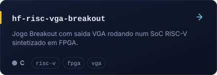
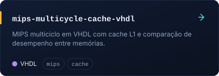
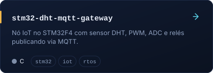
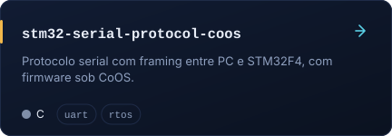
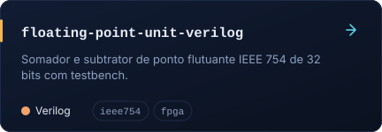
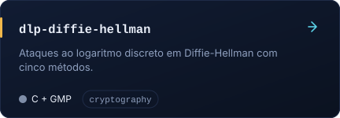
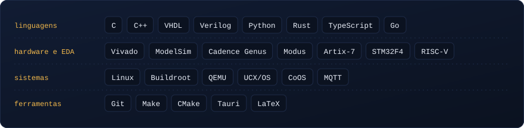

 

Estudante de **Engenharia de Computação na PUCRS**, com formatura em dezembro de 2026, e estagiário de **Engenharia de Produto na Midea Carrier**, em Canoas (RS). Gosto de trabalhar onde software e hardware se encontram: firmware em C, RTOS e drivers de um lado, VHDL, Verilog e FPGA do outro.

## Projetos em destaque

  
  

  
  

  
  

## Tecnologias

 

Os demais trabalhos da graduação estão na aba <a href="https://github.com/LukasEly?tab=repositories">Repositórios</a>.
