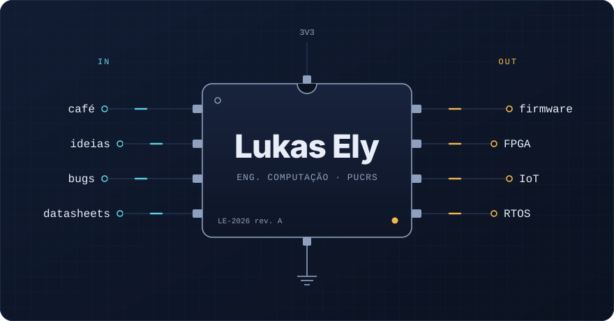

  

  <a href="https://github.com/LukasEly/hf-risc-vga-breakout">breakout em RISC-V</a> ·
  <a href="https://github.com/LukasEly/mips-multicycle-cache-vhdl">MIPS com cache</a> ·
  <a href="https://github.com/LukasEly/stm32-dht-mqtt-gateway">STM32 + MQTT</a> ·
  <a href="https://github.com/LukasEly?tab=repositories">todos os projetos</a>

